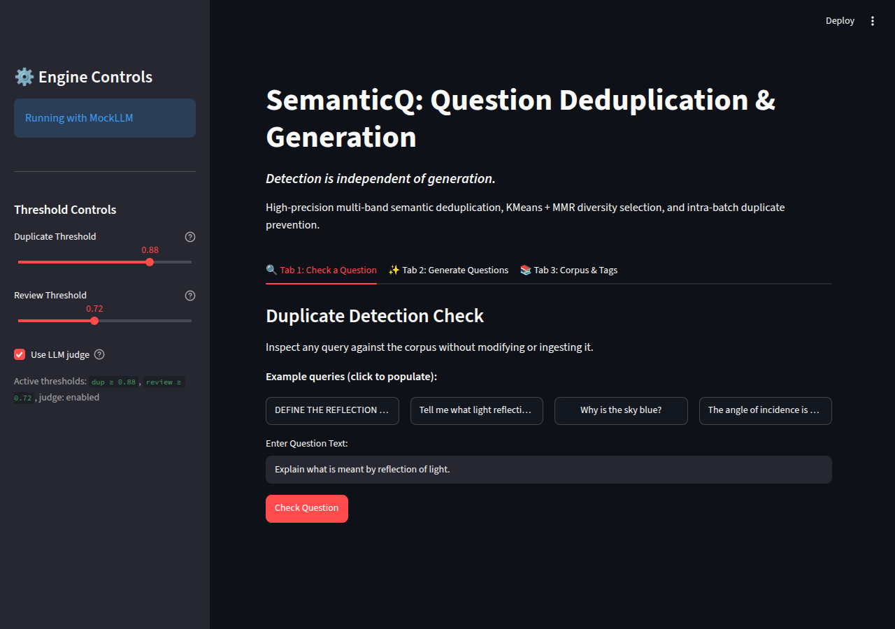
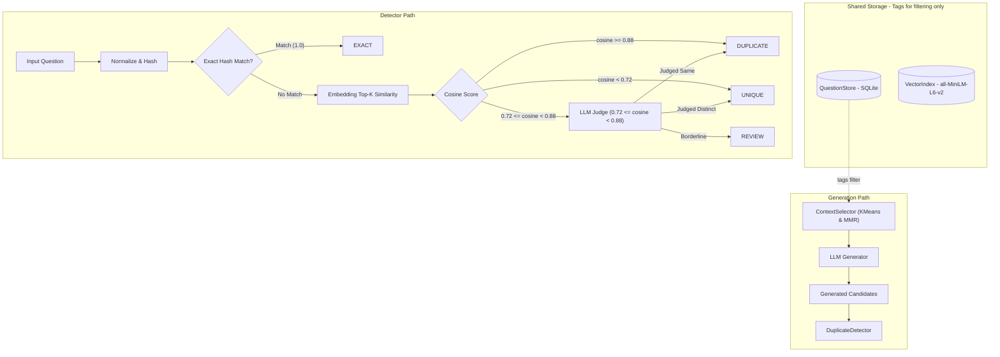

# question-dedup

Curriculum-aligned question generation, semantic duplicate detection, and context selection using sentence embeddings and Gemini LLM.

## Project Structure

```text
question-dedup/
├── .env.example              # Environment variables template (GEMINI_API_KEY)
├── README.md                 # Project documentation & evaluation results
├── requirements.txt          # Python dependencies
├── pyproject.toml            # Project packaging & pytest config
├── demo.py                   # Demonstration script
├── data/
│   └── corpus.json           # 10 labeled physics questions (Q1..Q10) with arbitrary JSON tags
├── src/
│   └── qdedup/
│       ├── __init__.py
│       ├── models.py         # Question dataclass (id, text, tags, normalized, text_hash)
│       ├── normalize.py      # NFKC normalization, punctuation stripping, sha256 hashing
│       ├── store.py          # SQLite store with JSON tags & BLOB/.npy embeddings
│       ├── embedder.py       # all-MiniLM-L6-v2 embedder with hash caching & VectorIndex
│       ├── detector.py       # Multi-band duplicate detector with LLM judge
│       ├── context_selector.py # Candidate pool pruning, KMeans clustering & MMR diversification
│       ├── generator.py      # Non-RAG question generation with intra-batch dedup & retry
│       └── llm.py            # LLMClient interface, GeminiLLM, and deterministic MockLLM
├── tests/                    # 38 unit & integration tests covering all modules
└── eval/                     # Evaluation benchmarks
    ├── evaluate.py           # Evaluation framework (Parts A-G) with rich reporting
    ├── extra_candidates.json # 7 extra labeled out-of-corpus test candidates
    └── results.md            # Generated evaluation metrics & ablation results
```

## Setup & Installation

1. Create a Python 3.11 virtual environment and activate it:
   ```bash
   uv venv .venv --python 3.11
   source .venv/bin/activate
   ```
2. Install dependencies:
   ```bash
   uv pip install -r requirements.txt
   uv pip install -e .
   ```
3. (Optional) Set up your Gemini API key in `.env`:
   ```bash
   cp .env.example .env
   # Edit .env and set GEMINI_API_KEY
   ```

## Running the Demo

The project includes a deterministic `MockLLM` so the entire pipeline runs offline without any API key:

```bash
python demo.py
```

## Running Tests

Run the full pytest suite (39 tests):

```bash
pytest -v
```

Run without the slow real-embedder tests:

```bash
pytest -m "not slow"
```

## Running the Evaluation Suite

Run the evaluation script to reproduce metrics, ablation, threshold sweep, and latency profiling:

```bash
python eval/evaluate.py
```

## Running the Web UI

Run the web UI:
```bash
streamlit run app.py
```



---

## Architecture & Workflow



---

## Evaluation

The deduplication architecture utilizes a multi-band decision routing mechanism:
- **EXACT**: Exact normalized text hash match (score = 1.0).
- **DUPLICATE**: Top neighbor cosine similarity $\ge 0.88$.
- **REVIEW Band ($0.72 \le \text{cosine} < 0.88$)**: Evaluates up to top 3 neighbors with the LLM judge. If any neighbor is judged same with confidence $\ge 0.70 \to$ `DUPLICATE`. If all evaluated neighbors are confidently different $\to$ `UNIQUE`. Otherwise $\to$ `REVIEW`.
- **UNIQUE**: All candidates have cosine $< 0.72$.

### A. Sequential Evaluation on Q1..Q10

Ingested sequentially in order $Q_1..Q_{10}$; each question $Q_i$ ($i \ge 2$) is evaluated against earlier questions only:

| ID | Question Text | Predicted | Expected | Cosine Score | Matched ID | Method | Status |
| :--- | :--- | :---: | :---: | :---: | :---: | :--- | :---: |
| **Q2** | Define the reflection of light. | `DUPLICATE` | `DUPLICATE` | 0.9678 | Q1 | `vector_cosine` | **PASS** |
| **Q3** | What do you understand by the reflection of light? | `DUPLICATE` | `DUPLICATE` | 0.8998 | Q1 | `llm_judge` | **PASS** |
| **Q4** | Explain the meaning of light reflection. | `DUPLICATE` | `DUPLICATE` | 0.9251 | Q2 | `llm_judge` | **PASS** |
| **Q5** | State the laws of reflection of light. | `UNIQUE` | `UNIQUE` | 0.8000 | — | `judge_distinct` | **PASS** |
| **Q6** | What is the angle of reflection? | `UNIQUE` | `UNIQUE` | 0.6980 | — | `below_threshold` | **PASS** |
| **Q7** | The angle of incidence is 30°. What is the angle of reflection? | `UNIQUE` | `UNIQUE` | 0.8307 | — | `judge_distinct` | **PASS** |
| **Q8** | What is reflection? | `UNIQUE` | `REVIEW` | 0.8743 | — | `judge_distinct` | **PASS (flagged)** |
| **Q9** | What is the difference between regular and diffuse reflection? | `UNIQUE` | `UNIQUE` | 0.6523 | — | `below_threshold` | **PASS** |
| **Q10** | Define the reflection of light. | `EXACT` | `EXACT` | 1.0000 | Q2 | `hash_match` | **PASS** |

### C. Classification Performance Metrics (Positive Class = EXACT + DUPLICATE)

| Partition | Precision | Recall | F1 Score | Confusion Matrix (TP / FP / TN / FN) |
| :--- | :---: | :---: | :---: | :---: |
| **Part A (Sequential Q1..Q10)** | 100.00% | 100.00% | 100.00% | 4 / 0 / 5 / 0 |
| **Part B (Extra Candidates)** | 100.00% | 100.00% | 100.00% | 3 / 0 / 4 / 0 |
| **Combined (A + B)** | **100.00%** | **100.00%** | **100.00%** | **7 / 0 / 9 / 0** |

- **False Positives (Costly: incorrectly marking unique questions as duplicates)**: None (0 FP)
- **False Negatives (missed duplicates)**: None (0 FN)

### D. Architecture Ablation Study

Comparison across system configurations on the combined benchmark:

| Configuration | Precision | Recall | F1 Score | TP / FP / TN / FN |
| :--- | :---: | :---: | :---: | :---: |
| **(1) Hash-Only** | 100.00% | 28.57% | 44.44% | 2 / 0 / 9 / 5 |
| **(2) Embedding-Only (0.88)** | 100.00% | 100.00% | 100.00% | 7 / 0 / 9 / 0 |
| **(2b) Embedding-Only, Strict 0.95** | 100.00% | 71.43% | 83.33% | 5 / 0 / 9 / 2 |
| **(3) Full Pipeline with Judge** | **100.00%** | **100.00%** | **100.00%** | **7 / 0 / 9 / 0** |

On this 16-item set, 0.88 alone separates all labels, but the margin is thin (Q3=0.90 vs Q8=0.87); the judge adds robustness, not measurable accuracy, here.

### E. Embedding-Only Cosine Threshold Sweep (0.60 to 0.95)

Evaluating classification behavior of raw embedding cosine similarity without the LLM judge:

| Threshold $\tau$ | Precision | Recall | F1 Score | False Positives (Costly) | False Negatives |
| :---: | :---: | :---: | :---: | :--- | :--- |
| **0.60** | 50.00% | 100.00% | 66.67% | Q5, Q6, Q7, Q8, Q9, E6, E7 | None |
| **0.65** | 50.00% | 100.00% | 66.67% | Q5, Q6, Q7, Q8, Q9, E6, E7 | None |
| **0.70** | 63.64% | 100.00% | 77.78% | Q5, Q7, Q8, E7 | None |
| **0.75** | 63.64% | 100.00% | 77.78% | Q5, Q7, Q8, E7 | None |
| **0.80** | 63.64% | 100.00% | 77.78% | Q5, Q7, Q8, E7 | None |
| **0.85** | 87.50% | 100.00% | 93.33% | **Q8** | None |
| **0.90** | 100.00% | 85.71% | 92.31% | None | **Q3** |
| **0.95** | 100.00% | 71.43% | 83.33% | None | **Q3, Q4** |

> [!NOTE]
> The threshold sweep clearly illustrates the trade-off in single-threshold systems:
> - At **$\tau \le 0.70$**, non-duplicate questions like **Q6** and **Q7** flip to False Positives.
> - At **$\tau \le 0.85$**, **Q8** flips to False Positive.
> - At **$\tau > 0.90$**, subtle paraphrases like **Q3** flip to False Negatives.
> This demonstrates why the LLM review band ($0.72 \le \text{cosine} < 0.88$) is necessary to resolve borderline cases without compromising precision or recall.

---

## Known Limitations

- **Presentation variants (fill-in-blank, MCQ, true/false) were NOT caught (0/3): cosine 0.79 / 0.66 / 0.71. Proposed fix: LLM-based rewrite of the candidate into a plain question stem before detection (future work). Regex canonicalization was considered and rejected as brittle.**
- **Mock Judge Validated, Real Gemini Judge Pending**: Pipeline is thoroughly validated offline with deterministic `MockLLM`; live Gemini judge evaluation is pending API key configuration (`GEMINI_API_KEY`).
- **16-Item Calibration Set**: Evaluation metrics are benchmarked on a 16-item calibration set and represent threshold tuning rather than a universal generalization claim.
- **Thin Margin**: The decision margin between borderline unique questions and duplicates is narrow (e.g. Q3 = 0.90 vs Q8 = 0.87).
- **Judge Dependency**: 6 of 16 evaluation items depend on the LLM judge for conclusive classification.
- **Exact Duplicates in Cluster Counts**: Exact duplicates stored in the question corpus are included in cluster candidate counts.
- **English-Only Model**: The sentence transformer embedding model (`all-MiniLM-L6-v2`) is English-focused.
- **Latency Scope**: Latency benchmarks are measured on a tiny brute-force vector corpus.

---

## Caveats

100% metrics are on a 16-item set used for threshold calibration, not a generalization claim; 6 of 16 items depend on the mock judge; real Gemini judge run is pending; latency measured on 10-vector brute force only.

---

## Viva one-liners

- **Prevention reduces duplicates, detection catches the rest.**
- **Tags never affect similarity.**
- **Prompt size stays constant via retrieval + clustering.**
- **Embeddings measure topic similarity, not task equivalence, hence the judge.**
